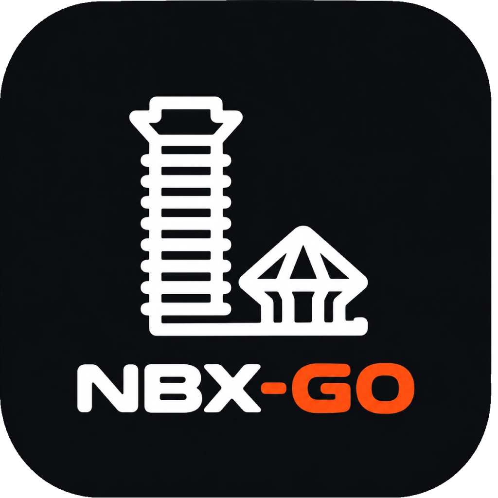

<p align="center">
  
</p>

<h1 align="center">NBX-go</h1>

<p align="center"><strong>The next step.</strong> A self-custodial wallet for the Hedera ecosystem — with an AI assistant that runs entirely on your phone.</p>

<p align="center">
  
  
  
  
</p>

---

NBX is built on **Hedera** and was incubated by the **NSE (Nairobi Securities Exchange)**. NBX-go is its wallet: your keys stay on your device, every trade settles on Hedera through **SaucerSwap**, and **GO** — the assistant — runs offline on **QVAC**, so your chats never leave the phone.

> **Beta.** NBX-go runs on Hedera **mainnet** with real funds. Start small. NBX is not responsible for financial decisions; GO gives information, not financial advice.

## Features

### Wallet
- **Self-custodial**, built on Tether's [WDK](https://docs.wdk.tether.io). Recovery phrase encrypted on-device; auto-locks in the background; password or biometrics to unlock.
- **Hedera-only**: HBAR, USDT0, SAUCE, xSAUCE, PLEX (Lambdaplex), DOVU, DAVINCI, KARATE — every token ID verified against SaucerSwap's and Lambdaplex's own lists.
- Send and receive with **QR scanning**, a Hedera **address book** (add contacts by QR), and **history** linked to HashScan.
- Beta **terms** agreed before any wallet is created or imported.

### Trade
- **Swap** any pair straight on **SaucerSwap V2** — routes built from live pools (direct or one hop via HBAR / USDC / USDT0 / SAUCE), quoted with QuoterV2, best route wins. Native HBAR in and out, automatic token association (HIP-719), price-impact warnings.
- **Spot trading** with live charts (TradingView Lightweight Charts, SaucerSwap candles) for every pair in USDT0.
- **Limit orders** — "buy SAUCE when it hits 0.009 USDT0": funds are set aside and the order fills on SaucerSwap when the price is reached, within 1% of your limit (while the app is open).
- **Earn** — SAUCE single-sided staking (xSAUCE) on SaucerSwap's Mothership, with live APR.
- Fiat on- and off-ramps (M-Pesa, card, bank) — *coming soon*.

### GO — the on-device assistant
- Runs **offline on QVAC**: text (Qwen3 / Llama 3.2), vision (SmolVLM2 / Qwen3-VL) and speech (Whisper) models, switchable for bigger ones on the Models page.
- Understands requests — *"buy 25 USDT of SAUCE"*, *"swap 100 HBAR to PLEX"*, *"send 10 USDT0 to Alice"*, *"stake my SAUCE"*, *"sell 5000 PLEX at 0.002"* — and proposes the step; **you confirm** every transaction on its own screen.
- Everyday requests — send, swap, buy/sell, stake, balance, transaction history — are understood instantly from keywords and your contact names, no model needed; GO asks for anything missing (amount, token, recipient).
- Answers balances and prices from live data (never from the model), knows NBX, and reads **chart screenshots** for patterns: Head & Shoulders, Double Top/Bottom, Flags, Pennants, Triangles and Wedges.
- Professional, informative and occasionally dry. Tap the orange suggestions to take them.

## Tech stack

| | |
|---|---|
| App | React Native 0.83 · Expo SDK 55 · Expo Router · NativeWind · Reanimated · zustand |
| Wallet | Tether WDK (`@tetherto/wdk-react-native-core`, Bare worklet) · Hedera JSON-RPC (Hashio) |
| Trading | SaucerSwap V2 (SwapRouter, QuoterV2, Mothership) · SaucerSwap REST · Hedera mirror node |
| Prices | WDK pricing (Bitfinex, CoinGecko fallback) · SaucerSwap |
| AI | QVAC SDK (llama.cpp + whisper.cpp), fully on-device |

## Build

Requirements: Node 20+, JDK 17, Android SDK (API 36), an arm64 Android phone.

```bash
npm install
cp .env.example .env   # set EXPO_PUBLIC_ADMIN_ADDRESS (platform-fee account); the rest is optional
npx expo prebuild --platform android
npm run link:wdk       # re-link WDK's native addons after prebuild
```

Debug (with Metro):

```bash
cd android && ./gradlew assembleDebug -PreactNativeArchitectures=arm64-v8a
npx expo start --dev-client
```

Release APK:

```bash
cd android && ./gradlew assembleRelease -PreactNativeArchitectures=arm64-v8a
# → android/app/build/outputs/apk/release/app-release.apk
```

Notes from building on Windows:
- The WDK worklet bundle (`.wdk-bundle/`, Hedera-only, ~4.5 MB) is committed; regenerate it with `npm run bundle:wdk` if you change `wdk.config.js` (this wrapper also fixes the bundler's `npx` call on Windows).
- Native libraries are stored compressed in the APK (`useLegacyPackaging`), roughly halving the download; Android unpacks them once at install.
- QVAC's Expo plugin replaces the native addons folder during prebuild — always run `npm run link:wdk` afterwards.
- `bare-node-runtime` is pinned to 1.5.0 (1.5.2 pulls `bare-worker`, which hangs on mobile).

## Download

Get the latest APK from the NBX-go landing page. The beta is signed with a development key — Android will ask you to allow installing from this source.

## Credits & license

Built on Tether's [WDK React Native starter](https://github.com/tetherto/wdk-starter-react-native) — Apache License 2.0, see [LICENSE](LICENSE). Swaps by [SaucerSwap](https://saucerswap.finance), on-device AI by [QVAC](https://qvac.tether.io), network by [Hedera](https://hedera.com).
